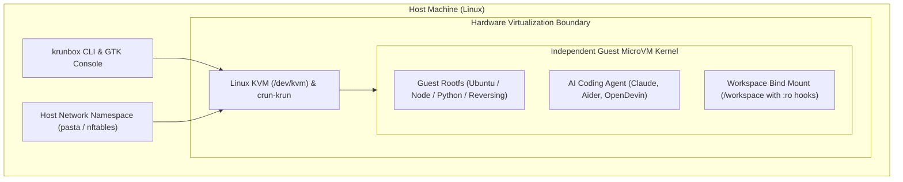
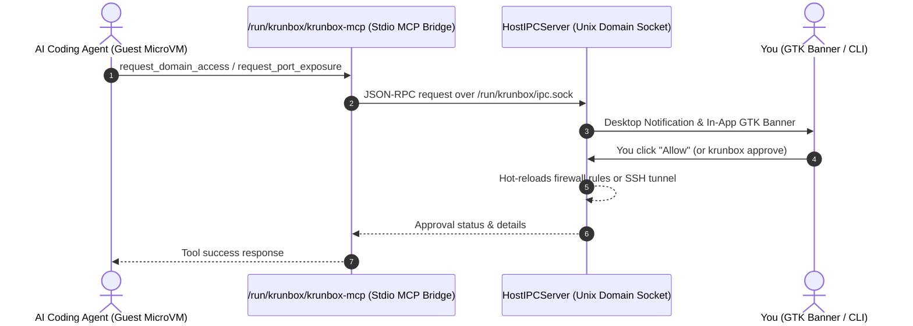

# How krunbox Works: Architecture & Under the Hood

**krunbox** is a lightweight microVM sandbox for Linux. It lets you run autonomous AI coding agents, untested repositories, and scratch environments inside an isolated Linux microVM in ~100ms.

Here is a breakdown of how the pieces fit together: from the hardware virtualization layer to the network egress firewall, git guardrails, and the GTK4 desktop console.

---

## 1. The Virtualization Layer: crun-krun & Linux KVM

Traditional containers and full virtual machines sit at opposite extremes:
- **Standard Containers (Docker, Podman with runc/crun)** share the host Linux kernel. If an untrusted process runs as root or exploits a kernel vulnerability, it's on your host machine.
- **Traditional VMs (VirtualBox, VMware, heavy QEMU)** run an independent kernel, but take 30+ seconds to boot, chew up gigabytes of idle RAM, and feel clunky for day-to-day hacking.

`krunbox` bridges this gap using **crun-krun** and **libkrun**:

1. **crun-krun (MicroVM Engine)**: Instead of starting a container process directly on the host kernel, `crun-krun` spins up a minimal guest Linux kernel inside a KVM virtual machine. The VM boots in ~100ms, using only the memory needed by the guest processes.
2. **Rootless Podman (Supervisor)**: krunbox uses rootless Podman as its container supervisor. It handles pulling OCI container images, setting up user namespaces (`/etc/subuid`, `/etc/subgid`), and configuring storage without requiring root privileges on your host.

---

## 2. Sandbox Lifecycle: Ephemeral vs. Persistent

Every sandbox has an explicit lifecycle model:

- **Ephemeral Mode (Default)**:
  - Launched with `--rm`.
  - When the sandbox stops, its temporary root filesystem is discarded.
  - Your host workspace files (`/workspace`) stay completely intact.
  - Great for one-off tasks, quick reviews, and letting an agent tackle an issue.
- **Persistent Mode (`-P` / `--persistent`)**:
  - Keeps installed packages, custom toolchains, and caches across reboots in a dedicated named volume.
  - Useful when you build a customized development environment and want to keep it around.

---

## 3. Network Egress Firewall: Keeping Agents on a Leash

When an AI agent runs autonomously, you usually want to control what it connects to. krunbox provides out-of-the-box egress profiles enforced via `nftables`:

- **`offline`**: Zero outbound network access. Complete airgap. Perfect for running security audits or analyzing untrusted binaries.
- **`ai-only`**: Only permits outbound traffic to known AI provider APIs (Anthropic, OpenAI, Gemini, Mistral, Ollama, HuggingFace) and DNS. The agent can think and generate code, but can't download random binaries or ping external servers.
- **`dev-common`**: Permits AI endpoints plus essential software registries (GitHub, npm, PyPI, Crates.io, Docker Hub) and OS mirrors.
- **`full`**: Unrestricted outbound internet connectivity, with optional blacklist support.
- **`custom`**: A user-defined whitelist of domains and CIDRs.

### Dual Filtering: Whitelists & Blacklists

- **Whitelist (`--allow` / `--whitelist`)**: Defines which domains are reachable.
- **Blacklist (`--deny` / `--blacklist`)**: Takes precedence over everything. Even under the `full` profile, blacklisted domains are dropped immediately before any allow rules are evaluated.

### Host-Side Enforcement: Why In-Guest Sudo Can't Escape

Many developer environments need `sudo` (e.g. for installing system libraries or running an inner Docker daemon). But if the guest has `sudo`, what stops a rogue script from running `sudo nft flush` to kill the firewall?

krunbox solves this with **host-boundary egress lockdown**:
- Packet filtering is attached at the host network namespace level (`pasta --no-map-gw`).
- Inside the guest microVM, `CAP_NET_ADMIN` is dropped via `setpriv --bounding-set=-net_admin` in `entrypoint.sh`.
- Even with root inside the microVM, the guest cannot modify the network filters enforced on the outside.

---

## 4. Workspace Git Guardrails, Snapshots & Rollback

Sharing your workspace folder (`-w /path/to/project`) with a sandbox is convenient, but poses subtle risks:

### 1. Git Hook Protection (`protect_git_hooks=True`)
A compromised agent could write a malicious script into `.git/hooks/pre-commit` or `.git/hooks/post-checkout`. When you later run `git commit` on your host workstation, that hook would execute with your full host privileges.

**How krunbox stops this**: By default, `/workspace/.git/hooks` is bind-mounted **read-only** (`:ro`) into the microVM. Any attempt to write or modify hooks fails with `Read-only file system`.

### 2. Pre-Run Snapshots & Rollback
Before an agent begins making changes, krunbox captures a clean workspace baseline:
- In Git repositories, it creates a fast git tree snapshot without touching your staging index.
- In non-Git directories, it captures a fast compressed archive.
- You can run `krunbox diff <name>` to view a colorized unified diff of everything the agent modified.
- If you like the result, accept it (`krunbox rollback <name> --accept`).
- If the agent wrecked your code, restore everything with one click (`krunbox rollback <name>`).

---

## 5. Port Forwarding & Editor Integration

Connecting your favorite tools to the sandbox should be effortless:

- **Static Ports (`-p 3000:3000`)**: Standard port publishing on launch.
- **Dynamic Port Forwarding (`krunbox forward <name> <port>`)**: Need to preview a web server the agent just started on port `5173`? Forward ports on *already running* sandboxes instantly using automated SSH reverse tunnels.
- **1-Click IDE Connect**: Launch directly into the microVM with VS Code (`krunbox code`), Cursor, Zed, or JetBrains Gateway.
- **SSH Config Isolation**: krunbox manages clean host entries in `~/.ssh/config.d/krunbox.conf`. Sandbox names are sanitized to prevent SSH directive injection.

---

## 6. In-Guest MCP Permission Gateway

When AI agents use the Model Context Protocol (MCP) to request actions (like exposing a port or requesting network access to a new domain), krunbox intercepts the request:

- **Unix Domain Socket Transport**: The agent talks to the host over a dedicated Unix domain socket (`/run/krunbox/ipc.sock`). No TCP ports or network interfaces are exposed for IPC.
- **Human in the Loop**: The agent pauses and waits for your confirmation in the GTK banner or CLI before access is granted.

---

## 7. Desktop App: Native GTK4 & Libadwaita

Instead of building another heavy Electron web app that burns 400 MB of RAM, `krunbox ui` is a native Linux application built with **GTK4 and Libadwaita**:

- Uses ~30 MB of resident memory.
- Adapts cleanly to system dark/light modes and GNOME accent colors.
- Provides real-time CPU and RAM utilization meters using `Gtk.LevelBar`.
- Non-blocking asynchronous worker threads keep the interface responsive even when heavy container commands are executing.

---

## 8. What's Next?

Want to explore future ideas, like the Zero-Secret Host API Proxy that keeps API keys completely out of the guest VM? Check out [Future Ideas & Roadmap](future_ideas.md).
