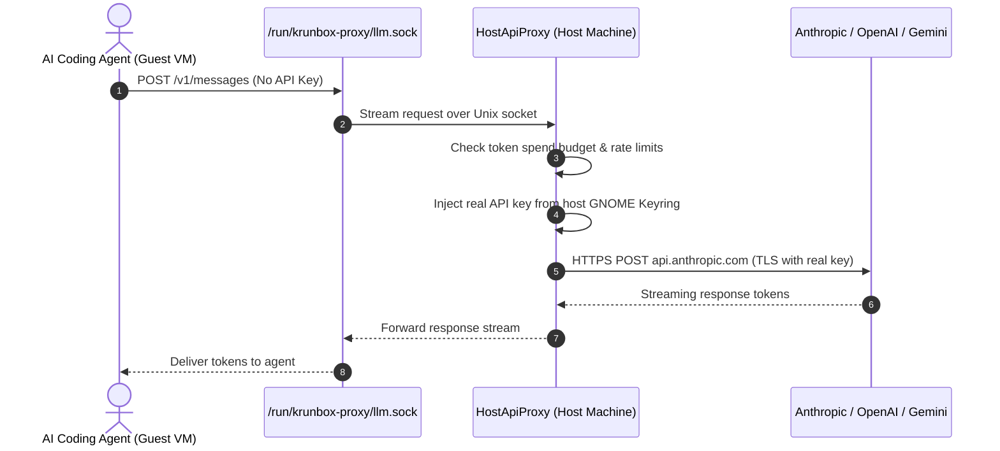

# Future Ideas & Roadmap: Cool Things to Hack On

**krunbox** is an open-source project built by developers who want better, safer local tools.

Here are some of the exciting architectural ideas and features we're planning to hack on next. If any of these sound fun to you, contributions and discussions are very welcome!

---

## 1. Zero-Secret Host API Proxy: Keep API Keys Out of the VM

### The Idea
Today, when an AI coding agent inside a sandbox needs to call Claude, OpenAI, or Gemini, you have to pass an API key into the container (via `-e ANTHROPIC_API_KEY=...` or an env file).

While the microVM stops the agent from touching your host files, any process running inside that sandbox can still read the environment variables. If a prompt injection tricks the agent into dumping its environment, or if a malicious npm package scans `/proc/self/environ`, your API key could be leaked.

### The Solution: Host-Side Key Injection
Instead of giving the guest VM the actual API key, we run a host proxy daemon that listens on a private Unix domain socket mounted into the microVM:

### Why This Is Awesome:
1. **The VM Never Sees the Secret**: Even if an agent runs `env` or inspects memory, the API key simply does not exist inside the microVM.
2. **Host-Side Spend Limits**: The host proxy can enforce hard token or dollar limits per sandbox (e.g., "stop after $2.00 of Claude 3.5 Sonnet").
3. **No Key Rotation Needed**: If a sandbox gets corrupted, you don't need to rotate your API key because the sandbox never had it in the first place.

---

## 2. Rootless GPU Passthrough (`/dev/dri`)

Right now, krunbox is optimized for CPU workloads and API-driven agents. But running small local models (Ollama, `llama.cpp`, Whisper) directly inside the microVM is becoming very popular.

- **The Plan**: Allow passing host GPU device nodes (`/dev/dri/renderD128`) into `crun-krun` microVMs without requiring root privileges.
- **Benefits**: Local embedding generation, local vision models for browser agents, and running small coding models completely offline with zero API costs.

---

## 3. Ephemeral OverlayFS Workspaces

Currently, the workspace directory (`-w /path/to/project`) is directly bind-mounted so the agent can write code.

- **The Plan**: Mount `/workspace` with a temporary `overlayfs` upper layer on host tmpfs.
- **Benefits**:
  - The agent can write gigabytes of test files or trash the codebase without modifying a single byte of your host disk.
  - In the UI, you can review the diff. If you click **"Accept"**, the upper layer is merged into your host folder. If you click **"Discard"**, the upper layer is instantly freed from RAM, leaving zero trace.

---

## 4. Headless Chrome Browser Sidecar with Host DevTools

Many autonomous agents (like OpenDevin or browser automation scripts) launch a headless Chromium browser to test web applications.

- **The Plan**: Provide a pre-configured Chrome CDP (Chrome DevTools Protocol) bridge that safely tunnels CDP traffic over an isolated local socket.
- **Benefits**: You can open your host Chrome browser to `chrome://inspect` and watch the agent navigate the web, fill forms, and test your web app in real time.

---

## Want to Help?

Have an idea for a feature or want to help implement one of these?
- Check out [CONTRIBUTING.md](../CONTRIBUTING.md) for how to set up the dev environment.
- Join the discussion in our [GitHub Issues](https://github.com/teismar/krunbox/issues)!
