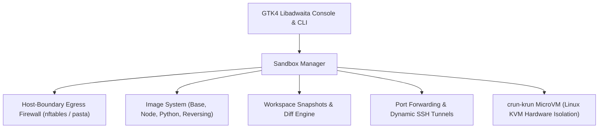

# Welcome to krunbox

**krunbox** gives you fast, hardware-isolated Linux microVM sandboxes for running AI coding agents, untrusted scripts, and messy development workloads without putting your host machine at risk.

Under the hood, it pairs **crun-krun** (Linux KVM hardware virtualization) and rootless **Podman** with an outbound egress firewall, workspace git guardrails, instant IDE connectivity, and a native **GTK4 / Libadwaita** desktop console.

---

## Why krunbox?

Autonomous AI coding agents (Claude Code, OpenDevin, Aider, custom LLM loops) are incredibly useful, but giving an AI agent free rein in a terminal on your host machine is risky:

- **What if it executes a bad command?** A runaway script or hallucinated cleanup command can wipe directories or corrupt system configs.
- **What if a malicious prompt injection occurs?** If an agent reads a poisoned README, issue, or dependency that instructs it to inspect `~/.ssh`, `~/.aws`, or environment variables and send them to an external server, your credentials are gone.
- **What if it poisons your `.git/hooks`?** A rogue agent can modify `.git/hooks/pre-commit` inside your repository. The next time you commit on your host machine, that script executes with your full host privileges.

### Why not just use Docker?
Standard Docker and Podman containers share the **host Linux kernel**. If an agent has root access in the container (common when tools need to install packages or run daemons) or hits a kernel vulnerability, it can escape to the host.

### Why not traditional virtual machines?
Full VMs (VirtualBox, VMware, heavy QEMU) are slow to boot (30+ seconds), consume gigabytes of idle memory, and are awkward to wire into your daily workflow.

### The krunbox sweet spot
`krunbox` uses **crun-krun** and **libkrun** to boot an actual independent Linux kernel inside a lightweight microVM via `/dev/kvm` in **~100 milliseconds**. You get the speed and convenience of containers with the true hardware boundary of a hypervisor.

---

## Architecture Overview



---

## Desktop Console in Action

<p align="center">
  
</p>

*The native GTK4 / Libadwaita console showing active microVMs, real-time CPU/RAM LevelBars, and 1-click IDE split buttons.*

<div style={{display: 'flex', gap: '1rem', marginTop: '1.5rem', marginBottom: '1.5rem', flexWrap: 'wrap'}}>
  <div style={{flex: '1 1 45%'}}>
    
    <p style={{fontSize: '0.85rem', color: 'var(--ifm-color-emphasis-600)', textAlign: 'center'}}>Quick Sandbox Creation with hardware and egress controls</p>
  </div>
  <div style={{flex: '1 1 45%'}}>
    
    <p style={{fontSize: '0.85rem', color: 'var(--ifm-color-emphasis-600)', textAlign: 'center'}}>Real-time outbound domain traffic monitor and 1-click allow/block</p>
  </div>
</div>

---

## Highlights

### ⚡ Sub-Second MicroVM Boots
- Boots in ~100ms with real Linux KVM hardware virtualization.
- Run multiple sandboxes simultaneously; each gets its own independent microVM kernel, private network namespace, and dedicated volume storage.
- Ephemeral by default (`--rm`): stops cleanly and discards temporary state while keeping your host project files safe. Turn on persistent mode (`-P`) when you want to keep installed packages across reboots.

### 🛡️ Outbound Network Lockdown & Traffic Inspector
- Keep agents on a leash so they can't exfiltrate your secrets or scan your home network:
  - **`offline`**: Completely airgapped. Zero outbound access.
  - **`ai-only`**: Only permits connections to major AI provider APIs (Anthropic, OpenAI, Gemini, Mistral, Ollama, HuggingFace).
  - **`dev-common`**: AI endpoints plus package registries (GitHub, PyPI, npm, Docker Hub, Cargo).
  - **`full`**: Standard outbound internet access with blacklist support.
  - **`custom`**: Hand-picked whitelist of domains.
- **Host-boundary enforcement**: The egress firewall is applied outside the guest VM. Even if an agent runs `sudo` inside the sandbox, it cannot bypass or flush the firewall rules.
- **Live traffic monitor**: Inspect domain requests in real time via `krunbox traffic <name>` or the GUI traffic dialog. See exactly what your agent tried to contact.

### 🔒 Workspace Git Guardrails
- **Protected Git Hooks**: By default, `/workspace/.git/hooks` is mounted read-only (`:ro`). Untrusted code cannot plant malicious hooks that execute outside the sandbox.
- **Dotfile Protection**: Optionally mask `.git/config` and `.env` files (`--protect-git-config`, `--protect-env`) to keep local keys and remotes private.

### 📸 Snapshots, Diff & 1-Click Rollback
- Automatically captures a clean workspace baseline snapshot before each run.
- Inspect everything the agent modified with colorized unified diff previews (`krunbox diff <name>`).
- If things went sideways, restore your workspace back to its pre-run state with a single click (`krunbox rollback <name>`).

### 💻 1-Click IDE & Terminal Integration
- Jump directly into your running microVM with **VS Code**, **Cursor**, **Zed**, **JetBrains Gateway**, or your native desktop terminal emulator (Ptyxis, GNOME Terminal, Alacritty, Kitty, WezTerm, Ghostty).
- Dynamic SSH integration generates clean `~/.ssh/config.d/` entries with zero-configuration port forwarding.

### 🐧 Native GNOME & Libadwaita Desktop App
- Fast, responsive desktop console built with GTK4 and Libadwaita (`krunbox ui`).
- Uses ~30 MB of RAM (no heavy Electron wrapper).
- Real-time CPU and memory meters, modal dialogs for port forwarding and traffic monitoring, dark/light theme switching, and desktop notifications.

---

## Ready-to-Use Images

| Image | Description | Typical Use Case |
|---|---|---|
| **`agent-box:latest`** | Debian Bookworm (on krunbox-base), nested Docker daemon, Node.js, Python, Chrome headless | Autonomous coding agents (Claude Code, OpenDevin, Aider) |
| **`python-data`** | Python 3.12, `uv`, NumPy, pandas, PyTorch, Jupyter | Data science, machine learning, and script testing |
| **`node-fullstack`** | Node.js 22 LTS, npm, pnpm, Playwright | Web development and frontend testing |
| **`reversing`** | Ghidra, Rizin, GDB, Wabt, Patchelf, Python binary analysis | Safe binary analysis and reverse engineering |
| **`debian-minimal`** | Debian Bookworm minimal rootfs | Lightweight, resource-constrained tasks |

---

## Getting Started

### Prerequisites
- A modern Linux distribution (Fedora, Ubuntu, Debian, Arch, etc.).
- KVM access (`/dev/kvm` readable and writable by your user).
- `podman`, `crun-krun`, and `passt`.

Check your system with:
```bash
# Verify your KVM group permissions
ls -la /dev/kvm
```

### Installation

Install via `pipx` (recommended) or editable pip:

```bash
# Install with pipx
pipx install .

# Or editable install for local development
pip install -e .

# Install the GNOME desktop launcher and icon
krunbox install-desktop
```

### Verify Your Environment

Run the built-in diagnostic tool to make sure hardware virtualization and runtimes are good to go:

```bash
krunbox doctor
```

---

## Quick Examples

### 1. Run a sandbox in your current project
```bash
# Start an ephemeral microVM mounted to current directory
krunbox run .

# Or start it in the background
krunbox run . -d
```

### 2. Lock down networking for an AI agent
```bash
# Only allow connections to AI APIs, with git hooks protected
krunbox run . --network ai-only --protect-git-hooks -d
```

### 3. Connect from your terminal or editor
```bash
# Open an interactive SSH terminal
krunbox connect my-project

# Launch directly in VS Code
krunbox code my-project
```

### 4. Check what changed and roll back if needed
```bash
# See which files were touched
krunbox diff my-project

# Revert a bad file
krunbox rollback my-project --file messy_script.py

# Or roll back all workspace changes
krunbox rollback my-project
```

### 5. Launch the desktop GUI
```bash
krunbox ui
```
